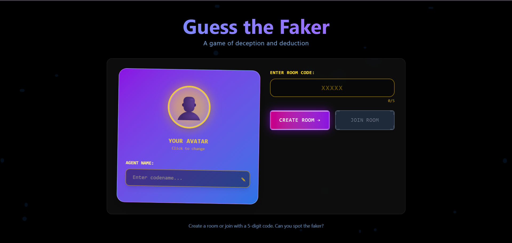
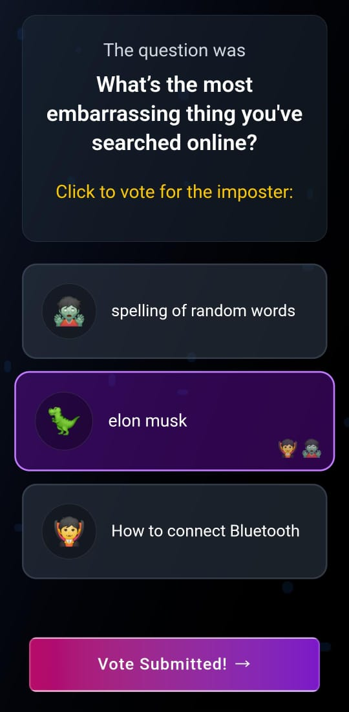

# 🎭 Guess The Faker - Real-time Multiplayer Social Deduction Game


**Guess The Faker** is a fun, fast-paced online multiplayer game built using the **MERN stack** and **Socket.IO**. It challenges players to spot the *faker* among them through social deduction, quick thinking, and deception — all in real-time.

---

## 🚀 Live Demo

- 🔗 **Frontend**: [https://guessthefaker.onrender.com](https://guessthefaker.onrender.com)  
- 🔗 **Backend API**: [https://guessthefaker-backend.onrender.com](https://guessthefaker-backend.onrender.com)

---

## 🖼️ Screenshots

<div align="center" style="display: flex; justify-content: center; gap: 20px; align-items: flex-start; flex-wrap: wrap;">
  <div style="flex: 1; min-width: 300px; max-width: 500px;">
    
    <p align="center" style="margin-top: 10px;">Desktop View</p>
  </div>
  <div style="flex: 1; width: 250px;">
    
    <p align="center" style="margin-top: 10px;">Mobile View</p>
  </div>
</div>

---

## 🕹️ How to Play

1. **Join a Room**: Minimum **3 players** are required to start a game.
2. **Answer Questions**: Everyone receives the same question except for one player — the *faker* — who gets a different one.
3. **Reveal & Guess**: After all players submit their answers, you must try to figure out who the faker is!
4. **Score Points**: Correctly guess the faker or trick others to earn points!

📋 Game instructions and rules are displayed on the homepage of the application.

---

## 🛠️ Tech Stack

- **Frontend**: React, Tailwind CSS, Socket.IO Client
- **Backend**: Node.js, Express.js, Socket.IO Server
- **Hosting**: Render

---

## 👥 Contributions Welcome!
Love the game? Want to improve it? We’d love your help! Here’s how:

🐛 Report bugs by opening an issue.

💡 Suggest features or improvements.

🔧 Submit pull requests for fixes or enhancements.

First time contributing? Check out GitHub’s guide to get started.

---

## 📦 Installation (For Local Development)

### ⚙️ Prerequisites

- Node.js and npm installed
- Git installed

---

### 🔧 Step-by-Step Setup

-Clone the repo
```bash
# 1. Clone the repository
git clone https://github.com/Ishantmishra18/GuesstheFaker.git
cd GuesstheFaker

```
-Run Backend ( from root directory )
```bash
# 2. Run Backend
cd server
npm install
npx nodemon server.js
```


-Run Frontend ( from root directory )
```base
# (in a new terminal)
# 3. Run Frontend
cd client
npm install
npm run dev


